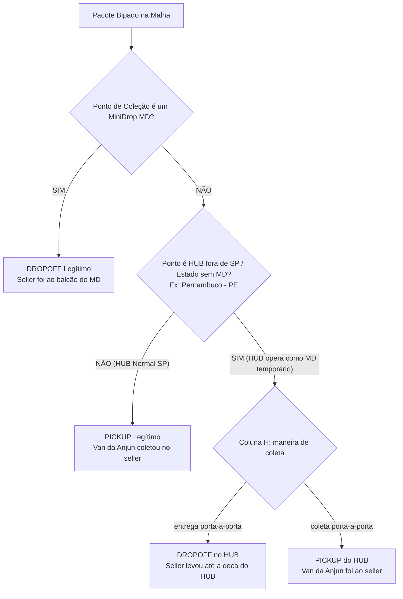

# 📘 REGRAS OPERACIONAIS OFICIAIS — TORRE DE CONTROLE ANJUN

> **Documento de Referência Permanente para Agentes, Desenvolvedores e Operação.**  
> *Última revisão e consolidação oficial: 04/11/2026.*  
> **Atenção:** Qualquer agente ou rotina que atue nesta base DEVE ler e seguir rigorosamente estas definições.

---

## 1. Dicionário Operacional dos Status de Pedidos (First-Mile ANJUN)

A esteira de First-Mile (FM) da Anjun possui status com significados físicos e operacionais muito específicos:

| Status no Sistema | Quem Bipa / Significado Físico Real | Classificação Operacional | Ação / Alerta |
| :--- | :--- | :--- | :--- |
| **`coletado`** | **BIPE DO MINIDROP** (ou parceiro de balcão) | **Backlog no MD** | Pacote sob custódia física do MiniDrop parceiro aguardando retirada pela van da Anjun. |
| **`saco selado`** | **BIPE DO MINIDROP** (ou parceiro de balcão) | **Backlog no MD (Saca Fechada)** | Pacotes consolidados em saca lacrada no MD aguardando o motorista de linha recolher. |
| **`Carregamento`** | **BIPE DA ANJUN** (Motorista / Equipe Anjun) | **Em Trânsito** | Carga bipada pelo motorista da Anjun no veículo em deslocamento para o HUB/Cross-docking. |
| **`Descarregamento`** | **BIPE DA ANJUN** (Doca / Triagem Anjun) | **Em Trânsito / Recepção HUB** | Carga descarregada na esteira/doca do HUB central da Anjun para triagem. |
| **`Circuito fechado`** | **Ciclo First-Mile Concluído com Sucesso** | **Concluído FM ➔ Rumo ao LM** | Pacote percorreu todo o ciclo da First Mile e deu tudo certo; é direcionado ao Last Mile (LM) para entrega ao comprador. |
| **`Foi assinado`** | **CRÍTICO: POSSÍVEL EXTRAVIO DO PACOTE!** | **Anomalia Grave de Saca** | **A saca lacrada chegou à etapa final de destino, MAS o pacote individual NÃO estava dentro dela!** Requer auditoria imediata. |
| **`Cancelado`** | Pedido cancelado | Cancelamento | Cancelado pelo marketplace, seller ou comprador antes/durante a coleta. |
| **`Não coletado`** | Pedido gerado no sistema | Aguardando Primeiro Bip | Etiqueta impressa pelo seller, mas carga ainda não apresentada ou coletada fisicamente. |

---

## 2. Marketplaces, Sellers e Modalidades (D2D vs W2D)

### ⚠️ Regra Fundamental: Não assumir premissas fixas por cliente
* **Qualquer Marketplace (Shein, TikTok, TEMU, Kwai) ou Seller pode movimentar tanto pacotes D2D quanto W2D.**
* **Nunca deduza a modalidade apenas pelo nome da plataforma ou cliente.**
* O que define categoricamente a modalidade e a operação é o cruzamento de duas colunas fundamentais:
  1. **Coluna H (`maneira de coleta`):**
     * `entrega porta-a-porta` ➔ Seller entregando no ponto/MD.
     * `coleta porta-a-porta` ➔ Veículo da Anjun coletando no seller.
  2. **Coluna BH (`Tipo do pedido`):**
     * `Pedidos D2D` ➔ Fluxo Door-to-Door / MiniDrop First-Mile.
     * `Normal` / `W2D` ➔ Fluxo de coleta tradicional em armazém/galpão.
     * `Cut-off` ➔ Janela de corte operacional.
     * `Pedido de carga grande` ➔ Cargas volumosas com roteirização especial.

### 🏪 Flexibilidade dos MiniDrops (MDs):
Os MiniDrops (MDs) têm total flexibilidade operacional na malha:
* Podem receber **ambos os pacotes (W2D e D2D)**.
* Podem receber **ambas as modalidades** (`Entrega porta a porta` e `Coleta porta a porta`).

---

## 3. Regra de Ouro: Diferenciação DROPOFF vs PICKUP

Para classificar com precisão se uma operação foi **DROPOFF** ou **PICKUP**:

1. **Regra do MiniDrop (DROPOFF):**  
   * **Tudo o que for bipado por MD (não inclui HUB etc) deve ser considerado como DROPOFF.** O vendedor deslocou-se e entregou a carga no balcão parceiro.
2. **Regra Geral de HUB / Ponto Central (PICKUP):**  
   * **Tudo o que NÃO tiver MD no ponto de coleção é considerado uma coleta PICKUP**, quando a ANJUN vai direto no endereço do seller coletar. Nesses casos, o ponto de coleção registrado no sistema será geralmente um HUB central (ex: `WR-GLP-01`, `SP-10`, etc.).
3. **Exceção de HUBs fora do estado / Praças sem MiniDrops (Ex: Pernambuco - PE):**  
   * Em estados onde ainda não existe malha de MiniDrops implantada, o HUB regional da Anjun assume a função secundária de **MD (ponto de apoio temporário)**.
   * Nesses casos, a diferenciação é dada pela **Coluna H (`maneira de coleta`)**:
     * `entrega porta-a-porta` ➔ **DROPOFF** (o seller foi até a doca do HUB entregar).
     * `coleta porta-a-porta` ➔ **PICKUP** (a van da Anjun foi até as instalações do seller recolher).

---

## 4. Tipologia de Sellers: Sellers com PA (In-House) vs Somente Pickup

### 🏬 A. Seller com PA (Ponto Avançado / In-House Dedicado)
* **Como funciona:** A Anjun aloca uma **equipe operacional própria dentro das dependências do seller**.
* **Fluxo:** O seller fabrica e embala os pedidos ➔ A equipe Anjun in-house bipa os pacotes no local ➔ Os caminhões/vans de linha encostam e fazem a coleta da carga já bipada.
* **Perfil:** Sellers de altíssima escala, confecções massivas e grandes redes de varejo (Lojas Renner, Camicado, C&A, grandes confecções do Brás/Bom Retiro).

### 📦 B. Sellers Somente Pickup (Coleta Externa de Rota)
* **Como funciona:** A Anjun **NÃO** mantém equipe dedicada no local.
* **Fluxo:** O próprio seller embala, gera as etiquetas e deixa os lotes prontos ➔ A van da Anjun em rota de coleta passa no endereço, bipa e carrega os volumes.
* **Perfil:** Sellers independentes, PMEs, e-commerces médios e marcas regionais.

---

## 5. Mapeamento Completo das 66 Colunas da Planilha Oficial (`02-11.xlsx`)

Extraído diretamente do arquivo mestre de exportação da ANJUN:

| Col | Idx | Nome Oficial da Coluna | Descrição Operacional e Significado |
| :---: | :---: | :--- | :--- |
| **A** | 0 | `Número do pedido de coleta` | Código identificador da ordem de coleta gerada no sistema. |
| **B** | 1 | `Código de barras` | Código de barras do pacote (bipagem física). |
| **C** | 2 | `Número de pedido de cliente` | Número de tracking do embarcador / marketplace (ex: ANJZX...). |
| **D** | 3 | `No. do cliente` | **Código numérico de identificação: CONTÉM TANTO CÓDIGO DE SELLER QUANTO DE MARKETPLACE.** |
| **E** | 4 | `número da saca` | Código da saca de consolidação onde o pacote foi agrupado. |
| **F** | 5 | `Número de escaneamento do veículo` | Registro da viagem/rota do veículo de coleta (ex: AJV32858074). |
| **G** | 6 | `No. do pacote` | Código individual do pacote / etiqueta. |
| **H** | 7 | `maneira de coleta` | **MODALIDADE DE COLETA: `coleta porta-a-porta` vs `entrega porta-a-porta`.** |
| **I** | 8 | `parcel weight` | Peso aferido do pacote (kg). |
| **J** | 9 | `Package Affirmation Value` | Valor declarado da mercadoria para seguro e frete. |
| **K** | 10 | `TEMPO DE CRIAÇÃO DO PEDIDO` | Timestamp de geração da etiqueta/pedido pelo seller. |
| **L** | 11 | `Tempo previsto para a coleta` | SLA máximo contratual para coleta na origem. |
| **M** | 12 | `Tempo real para a coleta` | Timestamp exato em que a coleta foi realizada. |
| **N** | 13 | `Data de conclusão` | Timestamp de conclusão do ciclo operacional de first-mile. |
| **O** | 14 | `Status do pedido` | **STATUS ATUAL: `coletado`, `saco selado`, `Carregamento`, `Descarregamento`, `Circuito fechado`, `Foi assinado`, `Cancelado`.** |
| **P** | 15 | `ponto de coleção` | Código do ponto físico do primeiro bip (MD, Ponto de Apoio ou HUB). |
| **Q** | 16 | `Colectores` | Identificador do operador/agente responsável pela coleta. |
| **R** | 17 | `Carregadeiras` | Matrícula/login do operador que realizou o bip de carregamento no veículo. |
| **S** | 18 | `Tempo de carregamento` | Timestamp do bip de carregamento no veículo de transferência. |
| **T** | 19 | `Descarregadores` | Matrícula/login do operador que bipou o descarregamento na doca/HUB. |
| **U** | 20 | `Tempo de descarregamento` | Timestamp da entrada e conferência na doca de descarregamento. |
| **V** | 21 | `Número do Cliente Comerciante` | **ID exclusivo do Seller (Merchant ID). Identificador primário para inteligência de sellers.** |
| **W** | 22 | `Nome do Cliente Merchant` | **Razão Social ou Nome Fantasia do Seller na plataforma.** |
| **X** | 23 | `Número do grupo de lojas múltiplas` | Identificador para sellers com filiais ou múltiplas contas vinculadas. |
| **Y** | 24 | `Assinado por` | Nome/login do recebedor na etapa de assinatura de saca. |
| **Z** | 25 | `ponto de entrega` | Ponto de destinação intermediário ou HUB de entrega da transferência. |
| **AA** | 26 | `Tempo de Assinatura` | Timestamp de assinatura e conferência final do lote. |
| **AB** | 27 | `remetente` | **Nome do Remetente físico cadastrado na etiqueta / Loja expedidora.** |
| **AC** | 28 | `Tel. do remetente` | Telefone do remetente (com mascaramento LGPD). |
| **AD** | 29 | `email do remetente` | E-mail corporativo ou de contato do remetente. |
| **AE** | 30 | `CEP do remetente` | **CEP físico de origem da mercadoria (8 dígitos).** |
| **AF** | 31 | `Estado de origem` | Sigla da UF de origem (SP, RJ, MG, PR, SC, etc.). |
| **AG** | 32 | `Cidade de origem` | Município do galpão ou loja do vendedor. |
| **AH** | 33 | `área do envio` | Bairro / Sub-região cadastrada no endereço de origem. |
| **AI** | 34 | `avenida do envio` | Logradouro de origem do remetente. |
| **AJ** | 35 | `No. da porta do envio` | Número do imóvel de expedição. |
| **AK** | 36 | `Endereço do envio` | Endereço completo formatado da coleta de origem. |
| **AL** | 37 | `vizinho do envio` | Complemento / Ponto de referência do endereço de envio. |
| **AM** | 38 | `Nome do destinatário` | Nome do comprador final da encomenda. |
| **AN** | 39 | `Telefone do destinatário` | Telefone de contato do comprador. |
| **AO** | 40 | `email do destinatário` | E-mail do comprador (geralmente relay mascarado da plataforma). |
| **AP** | 41 | `CEP do destinatário` | CEP de destino final no Brasil. |
| **AQ** | 42 | `Estado de recebimento` | UF de entrega final da mercadoria. |
| **AR** | 43 | `Cidade de recebimento` | Cidade de destino do pacote. |
| **AS** | 44 | `Área de recebimento` | Bairro de entrega final. |
| **AT** | 45 | `avenida de recebimento` | Logradouro de entrega ao comprador. |
| **AU** | 46 | `No. da porta de recebimento` | Número da residência/prédio de destino. |
| **AV** | 47 | `O endereço de recebimento` | Endereço completo de entrega final. |
| **AW** | 48 | `vizinho do destinatário` | Ponto de referência da residência do destinatário. |
| **AX** | 49 | `Plataformas afiliadas` | Modalidade da transportadora parceira / linha expressa. |
| **AY** | 50 | `Número da factura do produto` | Número da NF-e (Nota Fiscal Eletrônica do Produto). |
| **AZ** | 51 | `Tipos de faturas de logística` | Tipo do documento fiscal de frete (CT-e / DACTE). |
| **BA** | 52 | `Número da fatura de logística` | Número do CT-e de transporte emitido. |
| **BB** | 53 | `Chave de fatura logística` | Chave de 44 dígitos da NF-e / CT-e autorizada na SEFAZ. |
| **BC** | 54 | `Tempo de cancelamento` | Timestamp de cancelamento do pedido (quando aplicável). |
| **BD** | 55 | `Motivo do cancelamento` | Causa do cancelamento (arrependimento, falta de estoque, timeout). |
| **BE** | 56 | `Coletando Número de Onda` | ID da Onda de Coleta (Wave Picking) para roteirização em lote. |
| **BF** | 57 | `Tempo de criação de números de onda` | Timestamp de geração da onda de coleta no WMS. |
| **BG** | 58 | `Código de coleção real` | Código do lote consolidado no momento da bipagem física. |
| **BH** | 59 | `Tipo do pedido` | **TIPO DO PEDIDO: `Normal`, `Pedidos D2D`, `Cut-off`, `Pedido de carga grande`.** |
| **BI** | 60 | `Volume e peso da embalagem` | Peso cubado calculado da embalagem. |
| **BJ** | 61 | `Peso de embalagem` | Peso bruto registrado em balança. |
| **BK** | 62 | `Comprimento(cm)` | Dimensão longitudinal da embalagem (cm). |
| **BL** | 63 | `Largura(cm)` | Dimensão transversal da embalagem (cm). |
| **BM** | 64 | `Altura(cm)` | Altura da embalagem (cm). |
| **BN** | 65 | `Saída do armazém do cliente` | Timestamp de saída física (expedição) no dock do seller. |

---

## 6. Classificação Estrita da Malha: MiniDrop (MD) vs HUB Central

### 🏪 A. O que É MiniDrop (MD Legítimo)
Lojas parceiras de rua, pontos de bairro e estabelecimentos comerciais credenciados para atendimento de balcão e recebimento de drop-offs.
* **Padrões de Nomenclatura Obrigatórios:**
  1. `[UF]-W-MDxxx` (Exemplos: `SP-W-MD245`, `RJ-W-MD199`, `MG-W-MD104`, `SP-W-MD384`).
  2. `MD-[SIGLA]-[01|02]` (Exemplos: `MD-HAV-01`, `MD-ETT-02`, `MD-ATL-01`, `MD-WON-01`, `MD-GAS-02`).
* **Regra de Alarme:** Apenas unidades com esses prefixos devem figurar na aba de **Anomalias em MiniDrops**.

### 🚚 B. O que NÃO É MiniDrop (HUBs e Centros de Triagem)
* **`WR-GLP-01`**: É o **HUB Central Anjun Guarulhos** (Centro de Triagem / Cross-docking Nacional). **NUNCA DEVE SER CLASSIFICADO COMO MINIDROP**. Não possui atendimento de balcão ao público e movimenta grandes lotes de transferência.
* **Centros Regionais de Transferência:** `SP-10`, `SP-12`, `SP-13`, `SC-88`, `MG-38`, `SP-Z-H001`, `RJ-25`, `RJ-28`.

---

## 7. Segmentação da Carteira de Clientes

A carteira de clientes da Anjun é dividida em **3 Segmentos Estratégicos**:

### 🛒 1. Marketplaces & Plataformas Globais
* **Shein**
* **Temu**
* **TikTok Logistics Brazil**
* **Kwai**
* **SZAnjun** (Crossborder)

### 🏬 2. PA — Pontos Avançados & Ship-from-Store (Grandes Redes de Varejo)
Grandes redes corporativas atendidas com equipe in-house ou coleta dedicada em lojas de shopping / centros de distribuição avançados:
* **Lojas Renner:** `rennercabreuva` (CD Cabreúva)
* **Camicado:** `camod`
* **Youcom:** `youcom` (Moda jovem do Grupo Renner)
* **C&A Brasil:** Dezenas de lojas de shopping mapeadas (`c&a_shopping morumbi`, `c&a_shopping ibirapuera`, etc.)
* **Ri Happy:** Lojas de shopping (`rihappy_eldorado`, `rihappy_shopinterlagos`...)
* **Casas Bahia**, **Samsonite**, **Hanesbrands**, **Lojas Melman**.

### 📦 3. Sellers de Pickup (Coleta Porta a Porta)
Vendedores independentes e marcas atendidas pelas vans da Anjun em rota:
* Exemplos: `B4A Tecnologia e Comércio`, `Lescent Varejo`, `Beauty Hub Varejo`, `Maxmix Ltda`, `Linda Casa Enxovais`, `Ap Cosmetics`, `Shopmulti`, `Zakat`, `Premici`, `Playkids`.

---

## 8. Regras de Dados, Fechamento e SLA

1. **Total Oficial Absoluto (D-1):**
   * No fechamento do dia anterior (D-1), o total de pedidos gerados reflete 100% da operação oficial Anjun (exemplo histórico: **1.030.159 pedidos em 03/11/2026**).
   * A sincronização extrai a amostra detalhada de pacotes, mas preserva nos cards macro o número oficial exato.
2. **Aging e SLA:**
   * **Faixa Verde:** Até 24 horas (Dentro do prazo de SLA).
   * **Faixa Amarela:** 24h a 48h (Atenção / Pré-alerta).
   * **Faixa Laranja:** 48h a 72h (Risco alto de estouro de SLA).
   * **Faixa Vermelha:** Acima de 72 horas (Crítico / Fora do SLA operacional).

---

## 9. Arquitetura de Robôs e Segurança da Aplicação

1. **Agendador 24/7 (`agendador_automatico.py`):**
   * Roda em segundo plano coletando dados hora a hora (07h às 23h), consolidando o D-1 às 00h05 e publicando o deploy noturno às 22h30.
2. **Assistente Telegram (`anjun_torre_bot`):**
   * Roda de forma contínua conectado ao token seguro em `backend/telegram_config.json`.
   * Dispara alertas proativos para o administrador quando o token da sessão web Anjun estiver prestes a expirar (< 6 horas) ou quando expirar.
3. **Segurança de Credenciais:**
   * Arquivos locais como `telegram_config.json`, `anjun_api_config.json` e pastas de logs estão inclusos no `.gitignore` e **NUNCA** devem ser commitados no GitHub.
