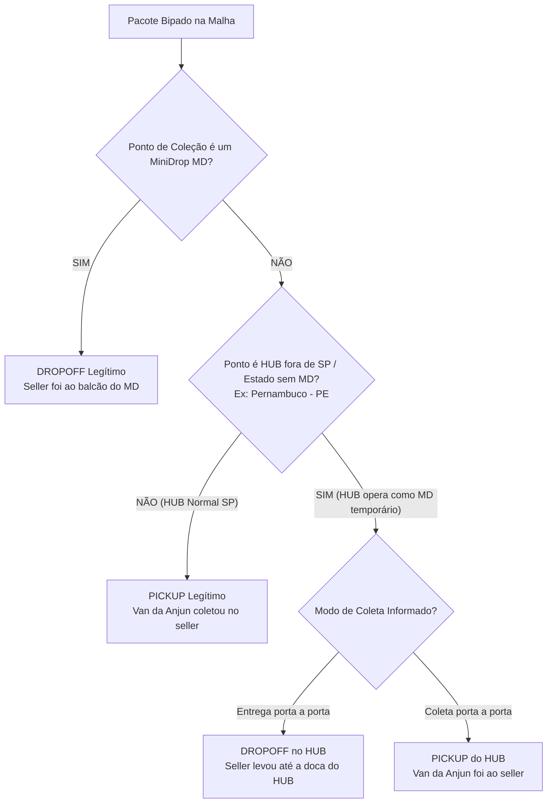

# 📘 REGRAS OPERACIONAIS OFICIAIS — TORRE DE CONTROLE ANJUN

> **Documento de Referência Permanente para Agentes, Desenvolvedores e Operação.**  
> *Última revisão e consolidação oficial: 04/11/2026.*  
> **Atenção:** Qualquer agente ou rotina que atue nesta base DEVE ler e seguir rigorosamente estas definições.

---

## 1. Dicionário Operacional de Nomenclaturas e Modalidades

| Termo no Sistema Anjun | Significado Operacional Real | Descrição / Dinâmica Fisiológica |
| :--- | :--- | :--- |
| **`entrega porta-a-porta`** | **Seller dropando no Ponto (Drop-off)** | O vendedor transporta os pacotes por conta própria e os entrega fisicamente no balcão do MiniDrop (MD) parceiro ou ponto de apoio. |
| **`coleta porta-a-porta`** | **Pickup da Van Anjun (Coleta Programada)** | A van/veículo da Anjun vai fisicamente até o endereço do seller (galpão, confecção, fábrica) recolher a mercadoria. |
| **`ponto_colecao`** | **Ponto de Bipagem de Custódia** | Ponto físico onde o pacote recebeu o primeiro bip de entrada na malha. |
| **`W2D`** | **Warehouse-to-Door / Pickup de Van** | Coleta tradicional porta a porta em galpões e indústrias para transporte ao HUB. |
| **`D2D`** | **Door-to-Door / Drop-off no MD** | Modalidade onde a maior parte dos pedidos (especialmente Shein D2D) é dropada no balcão de MiniDrops para agilizar o first-mile. |
| **`Circuito Fechado`** | **Ciclo Concluído / Entregue** | Pacote que percorreu toda a cadeia logística e teve a baixa final de entrega confirmada no destino. |
| **`Em Trânsito`** | **Carregamento & Descarregamento** | Carga bipada em transferência operacional entre MiniDrops, Pontos Avançados e HUBs centrais. |
| **`Backlog no MD`** | **Carga Retida no Balcão** | Pacotes bipados e sob custódia do parceiro no MiniDrop que ainda não foram carregados no veículo de coleta da Anjun. |
| **`Não Coletado`** | **Pedido Aberto no Sistema** | Pacote cuja etiqueta/pedido foi gerada na plataforma pelo embarcador, mas que ainda não recebeu o primeiro escaneamento físico na malha. |

---

## 2. Marketplaces Oficiais e Tipos de Pacotes

A Anjun opera com **4 grandes marketplaces principais**, cada um com suas modalidades de trânsito:

| Marketplace | Modalidades Suportadas | Características Operacionais |
| :--- | :---: | :--- |
| **SHEIN** | **D2D** e **W2D** | Maior volume da malha. Shein D2D é massivamente dropado em MiniDrops e W2D é coletado por vans. |
| **TIKTOK** | **W2D** e **D2D** | TikTok Logistics Brazil. Sellers de moda e consumo dropando em MDs ou atendidos por rotas de pickup. |
| **TEMU** | **W2D** e **D2D** | Operação nacional e transfronteiriça com sellers locais dropando em MDs e pickups dedicados. |
| **KWAI** | **W2D** e **D2D** | E-commerce e live-commerce em expansão nacional utilizando a rede de coleta e pontos. |

*Observação:* Os MiniDrops (MDs) têm total flexibilidade operacional e **podem receber ambos os pacotes (W2D e D2D)** e **ambas as modalidades** (`Entrega porta a porta` e `Coleta porta a porta`).

---

## 3. Regra de Ouro: Diferenciação DROPOFF vs PICKUP

Para classificar com precisão cirúrgica se um pacote ou fluxo foi um **DROPOFF** ou um **PICKUP**, aplica-se a seguinte lógica operacional:

### 🎯 Diretrizes Específicas:
1. **Regra do MiniDrop (DROPOFF):**  
   * **Tudo o que for bipado por MD (não inclui HUB etc) deve ser considerado como DROPOFF.** O vendedor deslocou-se e entregou a carga no balcão parceiro.
2. **Regra Geral de HUB / Ponto Central (PICKUP):**  
   * **Tudo o que NÃO tiver MD no ponto de coleção é considerado uma coleta PICKUP**, quando a ANJUN vai direto no endereço do seller coletar. Nesses casos, o ponto de coleção registrado no sistema será geralmente um HUB central (ex: `WR-GLP-01`, `SP-10`, etc.).
3. **Exceção de HUBs fora do estado / Praças sem MiniDrops (Ex: Pernambuco - PE):**  
   * Em estados onde ainda não existe malha de MiniDrops implantada, o HUB regional da Anjun assume a função secundária de **MD (ponto de apoio temporário)**.
   * Nesses casos, a diferenciação é dada pelo modo de coleta da remessa:
     * **`Entrega porta a porta`** ➔ **DROPOFF** (o seller foi até a doca do HUB entregar).
     * **`Coleta porta a porta`** ➔ **PICKUP** (a van da Anjun foi até as instalações do seller recolher).

---

## 4. Tipologia de Sellers: Sellers com PA (In-House) vs Somente Pickup

Nem todo seller que recebe coleta direta da Anjun opera da mesma forma. Existem dois modelos cruciais:

### 🏬 A. Seller com PA (Ponto Avançado / In-House Dedicado)
* **Como funciona:** A Anjun aloca uma **equipe operacional própria dentro das dependências do seller**.
* **Fluxo:** O seller fabrica e embala os pedidos ➔ A equipe Anjun in-house bipa os pacotes no local ➔ Os caminhões/vans de linha encostam e fazem a coleta da carga já bipada.
* **Perfil:** Sellers de altíssima escala, confecções massivas e grandes redes de varejo (Renner, Camicado, C&A, grandes confecções do Brás/Bom Retiro).

### 📦 B. Sellers Somente Pickup (Coleta Externa de Rota)
* **Como funciona:** A Anjun **NÃO** mantém equipe dedicada no local.
* **Fluxo:** O próprio seller embala, gera as etiquetas e deixa os lotes prontos ➔ A van da Anjun em rota de coleta passa no endereço, bipa e carrega os volumes.
* **Perfil:** Sellers independentes, PMEs, e-commerces médios e marcas regionais.

---

## 5. Dicionário de Colunas da Planilha e Extratos da Anjun

Ao processar relatórios brutos (`.xlsx`, `.csv` ou APIs detalhadas da Anjun), os campos do Seller e Marketplace estão distribuídos nas seguintes colunas oficiais:

| Coluna | Nome Oficial do Campo | Descrição e Uso no Sistema |
| :---: | :--- | :--- |
| **D** | **`No. do cliente`** | Código identificador do Cliente Pagador / Marketplace (ex: Shein, TikTok, Temu, Kwai, Renner). |
| **V** | **`Número do Cliente Comerciante`** | ID único / Código exclusivo do Seller (Merchant ID). Identificador primário para agrupamentos e ranking de sellers. |
| **W** | **`Nome do Cliente Merchant`** | Razão Social ou Nome Fantasia do vendedor na plataforma. |
| **AB** | **`remetente`** | Nome do Remetente físico / Loja expedidora cadastrada na etiqueta. |

---

## 6. Classificação Estrita da Malha: MiniDrop (MD) vs HUB Central

### 🏪 A. O que É MiniDrop (MD Legítimo)
Lojas parceiras de rua, pontos de bairro e estabelecimentos comerciais credenciados para atendimento de balcão e recebimento de drop-offs.
* **Padrões de Nomenclatura Obrigatórios:**
  1. `[UF]-W-MDxxx` (Exemplos: `SP-W-MD245`, `RJ-W-MD199`, `MG-W-MD104`, `SP-W-MD384`).
  2. `MD-[SIGLA]-[01|02]` (Exemplos: `MD-HAV-01`, `MD-ETT-02`, `MD-ATL-01`, `MD-WON-01`, `MD-GAS-02`).
* **Regra de Alarme:** Apenas unidades com esses prefixos devem figurar na aba de **Anomalias em MiniDrops**.

### 🚚 B. O que NÃO É MiniDrop (HUBs e Centros de Triagem)
* **`WR-GLP-01`**: É o **HUB Central Anjun Guarulhos** (Centro de Triagem / Cross-docking Nacional). **NUNCA DEVE SER CLASSIFICADO COMO MINIDROP**. Não possui atendimento de balcão ao público e movimenta grandes lotes de transferência.
* **Centros Regionais de Transferência:** `SP-10`, `SP-12`, `SP-13`, `SC-88`, `MG-38`, `SP-Z-H001`, `RJ-25`, `RJ-28`.

---

## 7. Segmentação Oficial da Carteira de Clientes

A carteira de clientes da Anjun é dividida em **3 Segmentos Estratégicos**:

### 🛒 1. Marketplaces & Plataformas Globais
* **Shein** (Shein Normal/W2D, Shein D2D, Shein W2S)
* **Temu** (Temu D2D, Temu W2D, Temu XBorder)
* **TikTok Logistics Brazil**
* **Kwai**
* **SZAnjun** (Internacional / Crossborder)

### 🏬 2. PA — Pontos Avançados & Ship-from-Store (Grandes Redes de Varejo)
Grandes redes corporativas atendidas com coleta dedicada em lojas de shopping ou centros de distribuição avançados:
* **Lojas Renner:** `rennercabreuva` (CD Cabreúva)
* **Camicado:** `camod`
* **Youcom:** `youcom` (Moda jovem do Grupo Renner)
* **C&A Brasil:** Dezenas de lojas de shopping mapeadas (`c&a_shopping morumbi`, `c&a_shopping ibirapuera`, etc.)
* **Ri Happy:** Lojas de shopping (`rihappy_eldorado`, `rihappy_shopinterlagos`...)
* **Casas Bahia**, **Samsonite**, **Hanesbrands**, **Lojas Melman**.

### 📦 3. Sellers de Pickup (Coleta Porta a Porta)
Vendedores independentes e marcas atendidas pelas vans da Anjun em rota:
* Exemplos: `B4A Tecnologia e Comércio`, `Lescent Varejo`, `Beauty Hub Varejo`, `Maxmix Ltda`, `Linda Casa Enxovais`, `Ap Cosmetics`, `Shopmulti`, `Zakat`, `Premici`, `Playkids`.

---

## 8. Regras de Dados, Fechamento e SLA

1. **Total Oficial Absoluto (D-1):**
   * No fechamento do dia anterior (D-1), o total de pedidos gerados reflete 100% da operação oficial Anjun (exemplo histórico: **1.030.159 pedidos em 03/11/2026**).
   * A sincronização extrai a amostra detalhada de pacotes, mas preserva nos cards macro o número oficial exato.
2. **Aging e SLA:**
   * **Faixa Verde:** Até 24 horas (Dentro do prazo de SLA).
   * **Faixa Amarela:** 24h a 48h (Atenção / Pré-alerta).
   * **Faixa Laranja:** 48h a 72h (Risco alto de estouro de SLA).
   * **Faixa Vermelha:** Acima de 72 horas (Crítico / Fora do SLA operacional).

---

## 9. Arquitetura de Robôs e Segurança da Aplicação

1. **Agendador 24/7 (`agendador_automatico.py`):**
   * Roda em segundo plano coletando dados hora a hora (07h às 23h), consolidando o D-1 às 00h05 e publicando o deploy noturno às 22h30.
2. **Assistente Telegram (`anjun_torre_bot`):**
   * Roda de forma contínua conectado ao token seguro em `backend/telegram_config.json`.
   * Dispara alertas proativos para o administrador quando o token da sessão web Anjun estiver prestes a expirar (< 6 horas) ou quando expirar.
3. **Segurança de Credenciais:**
   * Arquivos locais como `telegram_config.json`, `anjun_api_config.json` e pastas de logs estão inclusos no `.gitignore` e **NUNCA** devem ser commitados no GitHub.
