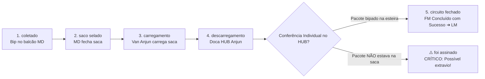
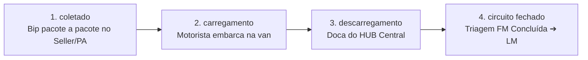

# 📘 REGRAS OPERACIONAIS OFICIAIS — TORRE DE CONTROLE ANJUN

> **Documento de Referência Permanente para Agentes, Desenvolvedores e Operação.**  
> *Última revisão e consolidação oficial: 04/11/2026.*  
> **Atenção:** Qualquer agente ou rotina que atue nesta base DEVE ler e seguir rigorosamente estas definições.

---

## 1. Os Dois Ciclos Operacionais da First-Mile (Máquinas de Estados)

A esteira de First-Mile (FM) da Anjun possui dois fluxos físicos distintos, dependendo da origem da mercadoria:

### 🏪 FLUXO 1: Pacotes Dropados no MiniDrop (MD) — Ciclo COM SACA
No modelo de MiniDrop, os pacotes são entregues no balcão parceiro e consolidados em sacas lacradas antes de seguirem viagem:



* **Ciclo Correto / Happy Path (100% Sucesso):**
  $$\text{coletado} \longrightarrow \text{saco selado} \longrightarrow \text{carregamento} \longrightarrow \text{descarregamento} \longrightarrow \text{circuito fechado}$$
* **Quando dá Ruim (Anomalias de MD):**
  1. **Falha de Saca (`foi assinado`):**  
     $$\text{coletado} \longrightarrow \text{saco selado} \longrightarrow \text{carregamento} \longrightarrow \text{descarregamento} \longrightarrow \mathbf{foi\ assinado}$$
     *A saca lacrada chegou fisicamente à etapa final, mas o pacote individual **NÃO estava dentro dela** (extravio dentro da saca ou pacote esquecido fora).*
  2. **Estagnação / Morte na Etapa (Backlog Parado):**  
     *O pacote morre em alguma etapa intermediária sem nunca atingir `circuito fechado` (ex: preso em `coletado`, parado em `saco selado` no MD sem coleta, ou preso em `carregamento`).*

---

### 🚚 FLUXO 2: Pacotes Pickup Direto no Seller ou PA — Ciclo SEM SACA (Pacote a Pacote)
Quando a Anjun vai coletar diretamente no galpão/loja do seller, ou opera dentro de um Ponto Avançado (PA / Ship-from-Store), a conferência é feita **pacote a pacote**, sem saca:



* **Ciclo Correto / Happy Path:**
  $$\text{coletado} \longrightarrow \text{carregamento} \longrightarrow \text{descarregamento} \longrightarrow \text{circuito fechado}$$
* **⚠️ REGRA DE OURO DO PICKUP E PA:**
  * **NÃO TEM A ETAPA `saco selado`!**  
  * No pickup e no PA a coleta é avulsa, pacote a pacote (volumes soltos, caixas ou pallets), **não existe saca**.
  * Se um pacote de pickup legítimo aparecer como `saco selado`, trata-se de anomalia de bipagem ou desvio operacional.
* **Quando dá Ruim no Pickup:**
  * O pacote é bipado como `coletado` no seller e "morre" ali (o motorista não deu `carregamento`), ou morre em `carregamento` sem dar `descarregamento` no HUB.

---

## 2. Dicionário Comparativo dos Status

| Status na Planilha | Significado no MiniDrop (Drop-off) | Significado no Pickup / PA | Classificação Geral | Ação da Torre / Alerta |
| :--- | :--- | :--- | :--- | :--- |
| **`coletado`** | Pacote recebido no balcão do parceiro. | Pacote bipado individualmente no seller/PA. | **Backlog em Aberto** | Se MD: aguardando ensacamento/van. Se Pickup: bipado na fábrica mas ainda retido. |
| **`saco selado`** | Saca lacrada pelo MD aguardando coleta. | **NÃO EXISTE EM PICKUP** (se houver, é anomalia). | **Backlog Ensacado (MD)** | Saca pronta no MD aguardando o motorista de rota. |
| **`Carregamento`** | Saca carregada no veículo Anjun. | Pacote avulso carregado no veículo Anjun. | **Em Trânsito** | Carga rodando no veículo rumo ao HUB de triagem. |
| **`Descarregamento`** | Saca descarregada na doca do HUB. | Pacote descarregado na doca do HUB. | **Em Trânsito / Recepção** | Carga na doca em processo de conferência e triagem. |
| **`Circuito fechado`** | Saca aberta, pacote conferido e liberado. | Pacote conferido na triagem e liberado. | **Concluído FM ➔ Rumo ao LM** | First-Mile 100% finalizado com sucesso! Liberado para Last-Mile ao comprador. |
| **`Foi assinado`** | Saca chegou, mas pacote não estava dentro! | Inconsistência de protocolo de entrega de lote. | **CRÍTICO: Possível Extravio** | Alerta vermelho de auditoria e acareação operacional. |
| **`Cancelado`** | Cancelado pelo seller/comprador. | Cancelado pelo seller/comprador. | **Cancelamento** | Baixa sem trânsito adicional. |
| **`Não coletado`** | Etiqueta emitida, sem entrada física. | Etiqueta emitida, sem entrada física. | **Aguardando Coleta** | Etiqueta pendente de primeiro bip. |

---

## 3. DROPOFF vs PICKUP: Como Medir com Precisão Cirúrgica

> **⚠️ Atenção sobre Nomenclaturas de Contrato (D2D, W2D, Cut-off, Normal):**  
> As nomenclaturas da Coluna BH (`Tipo do pedido`) refletem o perfil do pedido no marketplace, mas **NÃO determinam sozinhas se houve Pickup ou Drop-off**.  
> **O que realmente define se a operação foi PICKUP ou DROPOFF é o cruzamento da MANEIRA DA COLETA com o PONTO DE COLEÇÃO:**

```mermaid
flowchart TD
    Inicio[Pacote Bipado na Origem] --> CheckMD{Ponto de Coleção (Col P) é um MiniDrop MD?}
    CheckMD -- SIM (Bipado em MD) --> Dropoff[DROPOFF Legítimo\nMesmo que etiqueta diga 'coleta porta a porta',\nfoi recebido fisicamente pelo MD parceiro]
    CheckMD -- NÃO (Ponto é HUB / PA / Base) --> CheckManeira{Maneira da Coleta (Col H)?}
    CheckManeira -- coleta porta-a-porta --> Pickup[PICKUP Legítimo\nVan da Anjun foi ao endereço do seller recolher]
    CheckManeira -- entrega porta-a-porta --> DropoffHub[DROPOFF em HUB / Ponto de Apoio\nSeller deslocou-se e entregou na doca]
```

### Regras Mandatórias de Decisão:
1. **O Ponto de Coleção (Coluna P) tem precedência de recebimento:**  
   * Coleta porta-a-porta pode ser recebida fisicamente por um MiniDrop parceiro.
   * **Se o ponto de coleção for um MD, foi um DROPOFF** (o parceiro acolheu a mercadoria no balcão).
2. **Quando o Ponto de Coleção NÃO for um MD (HUBs, bases ou praças sem MD como PE):**  
   * Olha-se a **Maneira da Coleta (Coluna H)**:
     * `coleta porta-a-porta` ➔ **PICKUP** (a van da Anjun deslocou-se até o galpão/loja do seller).
     * `entrega porta-a-porta` ➔ **DROPOFF** (o seller levou os pacotes até o ponto de apoio/HUB).
3. **Todo Marketplace (Shein, TikTok, TEMU, Kwai) pode operar ambos os fluxos:**  
   * Nunca assumir que um marketplace só opera D2D ou W2D.

---

## 4. O Papel Vital da Atualização de Aging

O **Aging (Envelhecimento do Backlog e Ciclo de Vida)** é a espinha dorsal que garante a integridade dos dados na Torre de Controle:

### 🔄 Como Funciona a Dinâmica de Aging:
1. **Atualização Temporal Contínua:**  
   * Um pacote bipado no Dia 01 como `coletado` ou `saco selado` não permanece estático.  
   * Nos dias seguintes (Dia 02, 03, 04...), os novos extratos e bipagens atualizam o status desse mesmo código de barras para `Carregamento`, `Descarregamento` ou `Circuito fechado`.
2. **Garantia de Status Mais Atual:**  
   * O motor de reconciliação rastreia o histórico pelo código de barras (`Coluna B`) e atualiza a foto do pacote, garantindo que a operação sempre enxergue o **status mais recente real**.
3. **Monitoramento de Pacotes Parados (Faixas de Aging):**  
   * Os pacotes que **NÃO evoluem para `Circuito fechado`** vão acumulando dias de atraso (`dias_sem_atualizacao`):
     * 🟢 **0 a 24 horas (D0 / D1):** Fluxo operacional saudável dentro da esteira normal de coleta e transferência.
     * 🟡 **24h a 48h (D2):** Alerta de pré-estouro de SLA.
     * 🟠 **48h a 72h (D3):** Risco crítico.
     * 🔴 **Acima de 72h (> 3 dias):** Estouro formal de SLA / Pacote retido indevidamente ou possível extravio.
   * Essa métrica protege tanto pacotes esquecidos em **MiniDrops** quanto pacotes de **Pickup** coletados por motoristas mas que ainda não deram entrada no HUB!

---

## 5. Tipologia de Sellers: Sellers com PA (In-House) vs Somente Pickup

### 🏬 A. Seller com PA (Ponto Avançado / In-House Dedicado)
* **Como funciona:** A Anjun aloca uma **equipe operacional própria dentro das dependências do seller**.
* **Fluxo:** O seller fabrica e embala os pedidos ➔ A equipe Anjun in-house bipa os pacotes no local (pacote a pacote, sem saca) ➔ Os caminhões/vans de linha encostam e fazem a coleta da carga já bipada.
* **Perfil:** Sellers de altíssima escala, confecções massivas e grandes redes de varejo (Lojas Renner, Camicado, C&A, grandes confecções do Brás/Bom Retiro).

### 📦 B. Sellers Somente Pickup (Coleta Externa de Rota)
* **Como funciona:** A Anjun **NÃO** mantém equipe dedicada no local.
* **Fluxo:** O próprio seller embala, gera as etiquetas e deixa os lotes prontos ➔ A van da Anjun em rota de coleta passa no endereço, bipa individualmente (pacote a pacote) e carrega os volumes.
* **Perfil:** Sellers independentes, PMEs, e-commerces médios e marcas regionais.

---

## 6. Mapeamento das Colunas da Planilha Oficial (`02-11.xlsx`)

Extraído do arquivo mestre de 66 colunas da ANJUN:

| Col | Idx | Nome Oficial da Coluna | Descrição Operacional e Significado |
| :---: | :---: | :--- | :--- |
| **A** | 0 | `Número do pedido de coleta` | Código identificador da ordem de coleta gerada no sistema. |
| **B** | 1 | `Código de barras` | Código de barras do pacote (chave primária da reconciliação). |
| **C** | 2 | `Número de pedido de cliente` | Número de tracking do embarcador / marketplace (ex: `ANJZX...`). |
| **D** | 3 | `No. do cliente` | **Código numérico: contém tanto código de Seller quanto de Marketplace.** |
| **E** | 4 | `número da saca` | Código da saca de consolidação onde o pacote foi agrupado (apenas MD). |
| **F** | 5 | `Número de escaneamento do veículo` | Registro da viagem/rota do veículo de coleta (ex: `AJV32858074`). |
| **G** | 6 | `No. do pacote` | Código individual do pacote / etiqueta. |
| **H** | 7 | `maneira de coleta` | **Modalidade de Coleta: `coleta porta-a-porta` vs `entrega porta-a-porta`.** |
| **I** | 8 | `parcel weight` | Peso aferido do pacote (kg). |
| **J** | 9 | `Package Affirmation Value` | Valor declarado da mercadoria para seguro e frete. |
| **K** | 10 | `TEMPO DE CRIAÇÃO DO PEDIDO` | Timestamp de geração da etiqueta/pedido pelo seller. |
| **L** | 11 | `Tempo previsto para a coleta` | SLA máximo contratual para coleta na origem. |
| **M** | 12 | `Tempo real para a coleta` | Timestamp exato em que a coleta foi realizada. |
| **N** | 13 | `Data de conclusão` | Timestamp de conclusão do ciclo operacional de first-mile. |
| **O** | 14 | `Status do pedido` | **Status do pacote: `coletado`, `saco selado`, `Carregamento`, `Descarregamento`, `Circuito fechado`, `Foi assinado`, `Cancelado`.** |
| **P** | 15 | `ponto de coleção` | Código do ponto físico do primeiro bip (MD parceiro, Ponto de Apoio ou HUB). |
| **Q** | 16 | `Colectores` | Identificador do operador/agente responsável pela coleta. |
| **R** | 17 | `Carregadeiras` | Matrícula/login do operador que realizou o bip de carregamento no veículo. |
| **S** | 18 | `Tempo de carregamento` | Timestamp do bip de carregamento no veículo de transferência. |
| **T** | 19 | `Descarregadores` | Matrícula/login do operador que bipou o descarregamento na doca/HUB. |
| **U** | 20 | `Tempo de descarregamento` | Timestamp da entrada e conferência na doca de descarregamento. |
| **V** | 21 | `Número do Cliente Comerciante` | **ID exclusivo do Seller (Merchant ID). Identificador primário de sellers.** |
| **W** | 22 | `Nome do Cliente Merchant` | **Razão Social ou Nome Fantasia do Seller na plataforma.** |
| **X** | 23 | `Número do grupo de lojas múltiplas` | Identificador para sellers com filiais ou múltiplas contas vinculadas. |
| **Y** | 24 | `Assinado por` | Nome/login do recebedor na etapa de assinatura de saca. |
| **Z** | 25 | `ponto de entrega` | Ponto de destinação intermediário ou HUB de entrega da transferência. |
| **AA** | 26 | `Tempo de Assinatura` | Timestamp de assinatura e conferência final do lote. |
| **AB** | 27 | `remetente` | **Nome do Remetente físico cadastrado na etiqueta / Loja expedidora.** |
| **AC** | 28 | `Tel. do remetente` | Telefone do remetente (com mascaramento LGPD). |
| **AD** | 29 | `email do remetente` | E-mail corporativo ou de contato do remetente. |
| **AE** | 30 | `CEP do remetente` | **CEP físico de origem da mercadoria (8 dígitos).** |
| **AF** | 31 | `Estado de origem` | Sigla da UF de origem (SP, RJ, MG, PR, SC, etc.). |
| **AG** | 32 | `Cidade de origem` | Município do galpão ou loja do vendedor. |
| **AH** | 33 | `área do envio` | Bairro / Sub-região cadastrada no endereço de origem. |
| **AI** | 34 | `avenida do envio` | Logradouro de origem do remetente. |
| **AJ** | 35 | `No. da porta do envio` | Número do imóvel de expedição. |
| **AK** | 36 | `Endereço do envio` | Endereço completo formatado da coleta de origem. |
| **AL** | 37 | `vizinho do envio` | Complemento / Ponto de referência do endereço de envio. |
| **AM** | 38 | `Nome do destinatário` | Nome do comprador final da encomenda. |
| **AN** | 39 | `Telefone do destinatário` | Telefone de contato do comprador. |
| **AO** | 40 | `email do destinatário` | E-mail do comprador (geralmente relay mascarado da plataforma). |
| **AP** | 41 | `CEP do destinatário` | CEP de destino final no Brasil. |
| **AQ** | 42 | `Estado de recebimento` | UF de entrega final da mercadoria. |
| **AR** | 43 | `Cidade de recebimento` | Cidade de destino do pacote. |
| **AS** | 44 | `Área de recebimento` | Bairro de entrega final. |
| **AT** | 45 | `avenida de recebimento` | Logradouro de entrega ao comprador. |
| **AU** | 46 | `No. da porta de recebimento` | Número da residência/prédio de destino. |
| **AV** | 47 | `O endereço de recebimento` | Endereço completo de entrega final. |
| **AW** | 48 | `vizinho do destinatário` | Ponto de referência da residência do destinatário. |
| **AX** | 49 | `Plataformas afiliadas` | Modalidade da transportadora parceira / linha expressa. |
| **AY** | 50 | `Número da factura do produto` | Número da NF-e (Nota Fiscal Eletrônica do Produto). |
| **AZ** | 51 | `Tipos de faturas de logística` | Tipo do documento fiscal de frete (CT-e / DACTE). |
| **BA** | 52 | `Número da fatura de logística` | Número do CT-e de transporte emitido. |
| **BB** | 53 | `Chave de fatura logística` | Chave de 44 dígitos da NF-e / CT-e autorizada na SEFAZ. |
| **BC** | 54 | `Tempo de cancelamento` | Timestamp de cancelamento do pedido (quando aplicável). |
| **BD** | 55 | `Motivo do cancelamento` | Causa do cancelamento (arrependimento, falta de estoque, timeout). |
| **BE** | 56 | `Coletando Número de Onda` | ID da Onda de Coleta (Wave Picking) para roteirização em lote. |
| **BF** | 57 | `Tempo de criação de números de onda` | Timestamp de geração da onda de coleta no WMS. |
| **BG** | 58 | `Código de coleção real` | Código do lote consolidado no momento da bipagem física. |
| **BH** | 59 | `Tipo do pedido` | **Tipo do Pedido: `Normal`, `Pedidos D2D`, `Cut-off`, `Pedido de carga grande`.** |
| **BI** | 60 | `Volume e peso da embalagem` | Peso cubado calculado da embalagem. |
| **BJ** | 61 | `Peso de embalagem` | Peso bruto registrado em balança. |
| **BK** | 62 | `Comprimento(cm)` | Dimensão longitudinal da embalagem (cm). |
| **BL** | 63 | `Largura(cm)` | Dimensão transversal da embalagem (cm). |
| **BM** | 64 | `Altura(cm)` | Altura da embalagem (cm). |
| **BN** | 65 | `Saída do armazém do cliente` | Timestamp de saída física (expedição) no dock do seller. |

---

## 7. Classificação Estrita da Malha: MiniDrop (MD) vs HUB Central

### 🏪 A. O que É MiniDrop (MD Legítimo)
Lojas parceiras de rua, pontos de bairro e estabelecimentos comerciais credenciados para atendimento de balcão e recebimento de drop-offs.
* **Padrões de Nomenclatura Obrigatórios:**
  1. `[UF]-W-MDxxx` (Exemplos: `SP-W-MD245`, `RJ-W-MD199`, `MG-W-MD104`, `SP-W-MD384`).
  2. `MD-[SIGLA]-[01|02]` (Exemplos: `MD-HAV-01`, `MD-ETT-02`, `MD-ATL-01`, `MD-WON-01`, `MD-GAS-02`).
* **Regra de Alarme:** Apenas unidades com esses prefixos devem figurar na aba de **Anomalias em MiniDrops**.

### 🚚 B. O que NÃO É MiniDrop (HUBs e Centros de Triagem)
* **`WR-GLP-01`**: É o **HUB Central Anjun Guarulhos** (Centro de Triagem / Cross-docking Nacional). **NUNCA DEVE SER CLASSIFICADO COMO MINIDROP**. Não possui atendimento de balcão ao público e movimenta grandes lotes de transferência.
* **Centros Regionais de Transferência:** `SP-10`, `SP-12`, `SP-13`, `SC-88`, `MG-38`, `SP-Z-H001`, `RJ-25`, `RJ-28`.

---

## 8. Segmentação da Carteira de Clientes

1. **Marketplaces & Plataformas Globais:** Shein, Temu, TikTok Logistics Brazil, Kwai, SZAnjun.
2. **PA — Pontos Avançados & Ship-from-Store:** Lojas Renner (`rennercabreuva`), Camicado (`camod`), Youcom, C&A Brasil, Ri Happy, Casas Bahia, Samsonite, etc.
3. **Sellers de Pickup:** B4A, Lescent, Beauty Hub, Maxmix, Linda Casa, Ap Cosmetics, Shopmulti, etc.

---

## 9. Arquitetura de Robôs e Segurança da Aplicação

1. **Agendador 24/7 (`agendador_automatico.py`):**
   * Roda em segundo plano coletando dados hora a hora (07h às 23h), consolidando o D-1 às 00h05 e publicando o deploy noturno às 22h30.
2. **Assistente Telegram (`anjun_torre_bot`):**
   * Roda de forma contínua conectado ao token seguro em `backend/telegram_config.json`.
   * Dispara alertas proativos para o administrador quando o token da sessão web Anjun estiver prestes a expirar (< 6 horas) ou quando expirar.
3. **Segurança de Credenciais:**
   * Arquivos locais como `telegram_config.json`, `anjun_api_config.json` e pastas de logs estão inclusos no `.gitignore` e **NUNCA** devem ser commitados no GitHub.
