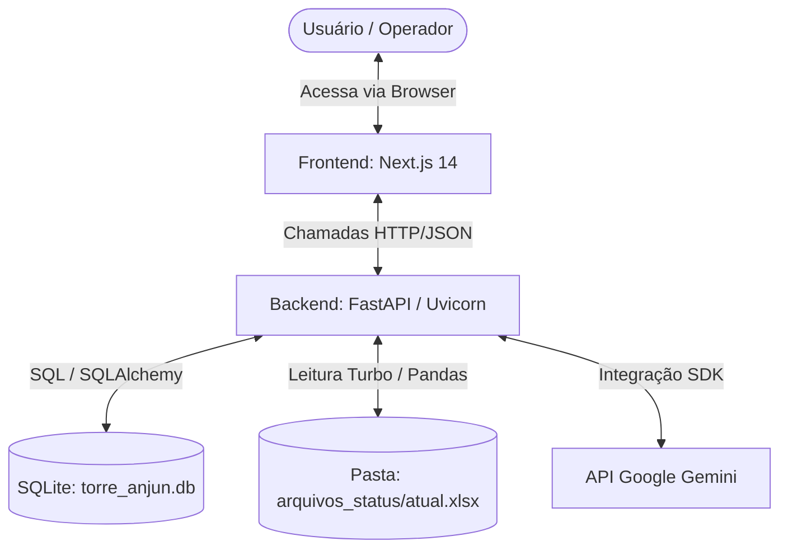

# 02 - Arquitetura do Sistema (Torre de Controle ANJUN)

Este documento detalha o design arquitetural da nova plataforma web da **Torre de Controle ANJUN**, projetada sob os princípios de desacoplamento, simplicidade de implantação local e alta performance de processamento.

---

## 1. Visão Geral da Arquitetura

O sistema é estruturado como um monorepo local contendo duas aplicações independentes:
1. **Frontend (Next.js SPA)**: Interface do usuário rica, focada em visualização dinâmica e responsiva de dados, rodando em React.
2. **Backend (FastAPI REST API)**: Camada de processamento de dados em Python, responsável pelas consultas ao banco de dados SQLite, leitura de planilhas locais e comunicação com a API do Google Gemini.

---

## 2. Componentes do Sistema

### A. Frontend (Next.js 14)
* **Arquitetura**: SPA (Single Page Application) utilizando o App Router do Next.js. Toda a renderização dinâmica de dados ocorre no lado do cliente (Client-Side Rendering - CSR) para garantir uma experiência de navegação instantânea.
* **Comunicação**: O cliente faz requisições assíncronas (`fetch`) para os endpoints da API REST e gerencia o estado da aplicação localmente.
* **Controle de Acesso**: Um componente/hook de segurança intercepta os parâmetros de busca (`searchParams`) diretamente na URL para injetar os filtros operacionais de regional ou master nas requisições subsequentes.

### B. Backend (FastAPI)
* **Framework**: FastAPI executando sob o servidor ASGI Uvicorn.
* **Banco de Dados**: SQLite gerenciado via SQLAlchemy (ORM) com sessões de banco independentes para cada requisição (injetadas via FastAPI Dependency Injection).
* **Processamento de Dados**: Utiliza a biblioteca **Pandas** e o motor **Calamine** para leitura ultrarrápida (Modo Turbo) das planilhas de status operacional (`atual.xlsx`).
* **CORS (Cross-Origin Resource Sharing)**: Configurado explicitamente para permitir requisições de origem cruzada a partir da porta padrão do Next.js (normalmente `localhost:3000`).

### C. Integração com Inteligência Artificial
* **Serviço**: SDK oficial do Google Gemini (`google-generativeai`).
* **Fluxo**: O frontend envia a solicitação de geração de relatório contendo o tipo de relatório desejado (WBR, Qualidade, Cobrança) e o contexto operacional pré-filtrado. O backend consolida os dados operacionais estruturados como Markdown e envia o prompt enriquecido ao Gemini, devolvendo a resposta diretamente em formato Markdown para exibição no chat da interface.

---

## 3. Fluxo de Dados e Integração Operacional

### A. Leitura de Planilhas de Status (Radar de Malha)
O sistema lê arquivos dinâmicos (extensões `.csv`, `.xlsx`, `.xls`) jogados localmente na pasta `arquivos_status/`:
1. O backend monitora e faz a leitura usando o motor **Calamine** para arquivos Excel grandes.
2. Identifica automaticamente o tipo de planilha e aplica a higienização de colunas (`mapear_colunas`).
3. Junta os dados com o mapeamento histórico de pontos de coleta cadastrados na tabela `detalhe_md_historico` para classificar as regionais e cidades automaticamente.
4. O resultado higienizado é retornado em formato JSON estruturado para exibição em tabelas com paginação e ordenação nativas do frontend.

### B. Gestão de Justificativas Operacionais
1. O operador da regional seleciona um dia operacional e insere uma justificativa na interface web.
2. O frontend envia uma requisição `POST /api/justificativas` com o payload JSON contendo data, regional e texto.
3. O backend persiste no banco SQLite na tabela `justificativas_diarias`.
4. Os dados atualizados são exibidos em tempo real para os perfis Master na tela de Visão Geral.
