# 06 - Banco de Dados (Torre de Controle ANJUN)

Este documento descreve o esquema físico de dados, relacionamentos e tipos de dados do banco de dados relacional embarcado **SQLite** (`torre_anjun.db`) utilizado como base pela **Torre de Controle ANJUN**.

---

## 1. Modelo de Entidades e Relacionamentos (ERD)

Abaixo está a representação conceitual das tabelas do banco de dados e suas conexões operacionais.

```mermaid
erDiagram
    historico_torre {
        INTEGER id PK
        TEXT dia_base
        INTEGER volume_total
        INTEGER volume_backlog
        REAL taxa_coleta
        REAL taxa_backlog
        INTEGER erros_lacre
        TEXT semana_base
    }

    detalhe_md_historico {
        INTEGER id PK
        TEXT dia_base
        TEXT semana_base
        TEXT md
        TEXT regional
        TEXT estado
        INTEGER total
        INTEGER backlog
        INTEGER carregamento
        INTEGER descarregamento
        INTEGER erros_md
        REAL taxa_coleta
        TEXT cidade
    }

    detalhe_cliente_historico {
        INTEGER id PK
        TEXT dia_base
        TEXT semana_base
        TEXT nome_cliente
        INTEGER total_pacotes
        INTEGER total_backlog
        REAL taxa_coleta
    }

    penalidades_md {
        INTEGER id PK
        DATE data_penalidade
        TEXT md
        TEXT motivo
        INTEGER pontos
    }

    justificativas_diarias {
        INTEGER id PK
        TEXT dia_base
        TEXT regional
        TEXT justificativa
        TIMESTAMP data_registro
    }

    md_observacoes_fixas {
        TEXT md PK
        TEXT observacao
    }

    avaliacao_md {
        INTEGER id PK
        TEXT md
        TEXT decisao
        TEXT motivo
        DATE data_avaliacao
    }

    ocorrencias_md {
        INTEGER id PK
        DATE data_registro
        TEXT md
        TEXT motivo
        TEXT observacao
    }

    detalhe_cliente_md_historico {
        INTEGER id PK
        TEXT dia_base
        TEXT semana_base
        TEXT nome_cliente
        TEXT md
        TEXT regional
        INTEGER total_pacotes
    }

    detalhe_pico_historico {
        INTEGER id PK
        TEXT dia_base
        TEXT md
        TEXT regional
        TEXT hora_bipagem
        INTEGER volume
    }

    detalhe_lacres_historico {
        INTEGER id PK
        TEXT dia_base
        TEXT md
        TEXT regional
        TEXT saca
        TEXT barcode
    }
```

---

## 2. Dicionário de Tabelas e Campos

### A. Tabela: `historico_torre`
Armazena consolidados diários globais de volume e eficiência logística.
* `id` (INTEGER, PK, Autoincrement): Identificador único.
* `dia_base` (TEXT): Data de referência no formato `DD/MM/AAAA`.
* `volume_total` (INTEGER): Quantidade de pacotes previstos para coleta no dia.
* `volume_backlog` (INTEGER): Quantidade de pacotes que ficaram retidos/acumulados.
* `taxa_coleta` (REAL): Porcentagem de coletas realizadas com sucesso.
* `taxa_backlog` (REAL): Porcentagem de backlog operacional.
* `erros_lacre` (INTEGER): Total de divergências em lacres de sacarias no dia.
* `semana_base` (TEXT): Código identificador da semana operacional correspondente.

### B. Tabela: `detalhe_md_historico`
Armazena a performance individualizada de cada Micro-Distribuidor (MD).
* `id` (INTEGER, PK, Autoincrement): Identificador único.
* `dia_base` (TEXT): Data de referência (`DD/MM/AAAA`).
* `semana_base` (TEXT): Semana operacional.
* `md` (TEXT): Nome do Micro-Distribuidor.
* `regional` (TEXT): Regional operacional de atuação (ex: SP, RJ, MG).
* `estado` (TEXT): Sigla do estado (UF).
* `total` (INTEGER): Carga total delegada ao MD.
* `backlog` (INTEGER): Carga retida no MD.
* `carregamento` (INTEGER): Pacotes despachados/carregados.
* `descarregamento` (INTEGER): Pacotes recebidos/descarregados.
* `erros_md` (INTEGER): Número de erros operacionais registrados para o MD no dia.
* `taxa_coleta` (REAL): Percentual de eficiência de coletas do MD.
* `cidade` (TEXT): Município de atuação do MD.

### C. Tabela: `detalhe_cliente_historico`
Consolida o volume de pacotes de clientes de marketplaces processados na Torre.
* `id` (INTEGER, PK, Autoincrement): Identificador único.
* `dia_base` (TEXT): Data de referência.
* `semana_base` (TEXT): Semana operacional.
* `nome_cliente` (TEXT): Nome do cliente marketplace.
* `total_pacotes` (INTEGER): Volume total de pacotes do cliente.
* `total_backlog` (INTEGER): Quantidade de pacotes parados do cliente.
* `taxa_coleta` (REAL): Taxa de coleta do cliente específico.

### D. Tabela: `justificativas_diarias`
Justificativas operacionais enviadas pelas regionais para explicar desvios de SLA ou backlogs.
* `id` (INTEGER, PK, Autoincrement): Identificador único.
* `dia_base` (TEXT): Data do dia operacional que está sendo justificado.
* `regional` (TEXT): Regional que cadastrou a justificativa.
* `justificativa` (TEXT): Detalhamento em texto do motivo do atraso/backlog.
* `data_registro` (TIMESTAMP): Data e hora automática do cadastro.

### E. Tabela: `avaliacao_md`
Registro das auditorias de conformidade dos Micro-Distribuidores.
* `id` (INTEGER, PK, Autoincrement): Identificador único.
* `md` (TEXT): Identificação do MD avaliado.
* `decisao` (TEXT): Status final atribuído (`Aprovado`, `Alerta`, `Suspenso`).
* `motivo` (TEXT): Justificativa da decisão de auditoria.
* `data_avaliacao` (DATE): Data em que a auditoria foi realizada.

### F. Tabela: `penalidades_md`
Armazena multas e pontuações negativas aplicadas a MDs fora de conformidade.
* `id` (INTEGER, PK, Autoincrement): Identificador único.
* `data_penalidade` (DATE): Data da penalização.
* `md` (TEXT): Nome do MD penalizado.
* `motivo` (TEXT): Motivo em formato texto (ex: atraso na bipagem, extravio).
* `pontos` (INTEGER): Pontuação a ser deduzida do score de saúde do parceiro.

---

## 3. Otimizações e Índices

Como a aplicação é executada em SQLite local e realiza consultas analíticas complexas combinando datas (`dia_base`), regionais e MDs, os seguintes índices compostos devem ser criados na base de produção para manter o tempo de resposta abaixo de 50ms:

1. `idx_detalhe_md_busca`: Criado na tabela `detalhe_md_historico` abrangendo as colunas `(dia_base, regional)`.
2. `idx_justificativas_busca`: Criado na tabela `justificativas_diarias` nas colunas `(dia_base, regional)`.
3. `idx_cliente_historico_busca`: Criado na tabela `detalhe_cliente_historico` na coluna `(dia_base)`.
