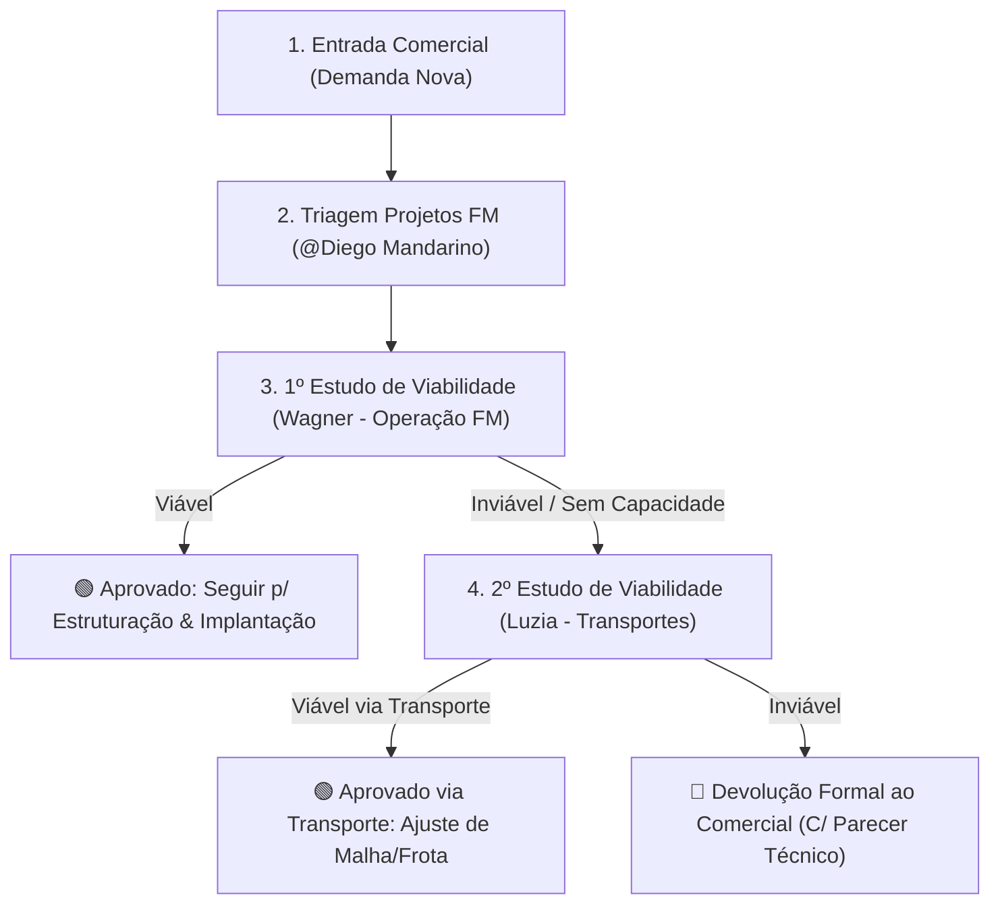

# Diretriz de Governança Oficial: Entrada de Solicitações FM (P.A & Pickup)

**Data de Aprovação:** 26 de Outubro de 2026  
**Áreas Envolvidas:** Comercial, Projetos First Mile, Operação FM, Transportes, TI/Infraestrutura e Gente & Gestão (RH).  
**Orquestrador do Fluxo:** @Diego de Souza Mandarino (Projetos FM)

---

## 1. Fluxo Macro de Triagem e Tomada de Decisão

Independentemente de a solicitação recebida ser de **Posto de Atendimento (P.A)** ou de **Coleta/Pickup**, o procedimento segue rigorosamente a governança sequencial abaixo:

### Regras de Ouro da Governança:
1. **Nenhuma solicitação pode ser recusada sumariamente pelo Wagner.** Caso o Wagner não consiga viabilizar pela operação direta, é **obrigatório** acionar a **Luzia (Transporte)** para verificar alternativas de linha/frota.
2. **Devolução ao Comercial:** Somente ocorre se **ambos** (Wagner e Luzia) confirmarem a inviabilidade. O motivo técnico deve ser formalizado no parecer operacional da Torre.

---

## 2. Matriz de Critérios e Pilares de Análise

### A. Solicitação de P.A (Posto de Atendimento Avançado)
A avaliação de viabilidade de um P.A deve auditar obrigatoriamente **3 PILARES**:

| Pilar | O que é analisado | Se NÃO tivermos disponível, quem acionar? |
| :--- | :--- | :--- |
| **1. ESTRUTURA** | Equipamentos e Mobiliário: PDAs, Desktops/PCs, Mesas de apoio, Impressoras térmicas, Leitores. | **Ryan**, **Link** e **Gabriel** (TI / Infraestrutura / Compras) |
| **2. FROTA** | Veículos para atendimento, transferência e janelas de corte (VUC, Van, Caminhão). | **Wagner** ou **Luzia** (Transportes) |
| **3. MÃO DE OBRA** | Colaboradores dedicados (Operadores, Assistentes, Líder de P.A). | **Wallace** (Gente & Gestão / RH Operações) |

---

### B. Solicitação de Pickup (Coleta / Coleta Externa / Dropoff)
A avaliação de viabilidade de uma Coleta/Pickup audita **2 PILARES**:

| Pilar | O que é analisado | Quem é responsável pela validação? |
| :--- | :--- | :--- |
| **1. ESTRUTURA** | Equipamento de bipagem: **PDA** (Zebra Android configurado). | **Operação FM** (ou alinhamento com Ryan/Link/Gabriel caso falte PDA) |
| **2. FROTA** | Disponibilidade de veículo e encaixe na rota/janela de coleta. | **Wagner** ou **Luzia** (Transportes) |

---

## 3. Matriz de Focais e Escopos de Responsabilidade

| Focal | Área / Função | Papel no Fluxo de Solicitações |
| :--- | :--- | :--- |
| **Diego Mandarino** | Projetos FM | Triagem das demandas comerciais, direcionamento de estudos, cobrança de prazos e formalização de devoluções. |
| **Wagner** | Operação FM | 1º Estudo de Viabilidade operacional e dimensionamento primário de frota. |
| **Luzia** | Transportes | 2º Estudo de Viabilidade (escalonamento de rotas, transportes rodoviários e frota alternativa). |
| **Ryan, Link & Gabriel** | TI & Infraestrutura / Compras | Suprimento e disponibilização de hardware (PDAs, PCs, Desktops) e mobiliário (Mesas) para P.As. |
| **Wallace** | Gente & Gestão (RH) | Dimensionamento, recrutamento e alocação de mão de obra para P.As. |
| **Comercial** | Vendas / Negócios | Emissão da solicitação inicial e receptor do parecer formal / Go-Live validado. |
